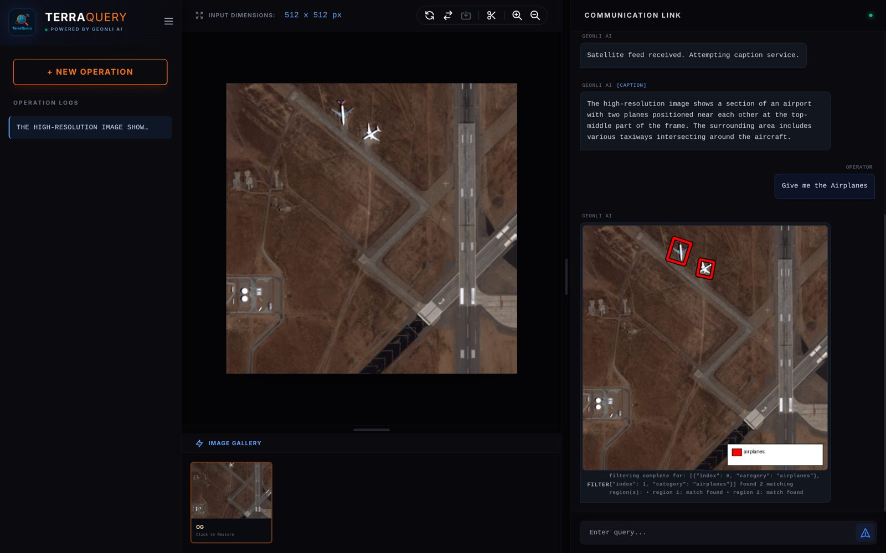
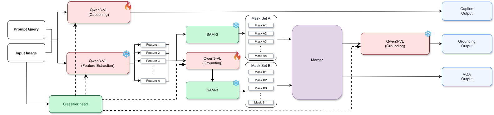
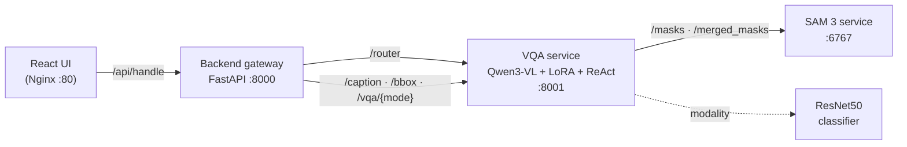
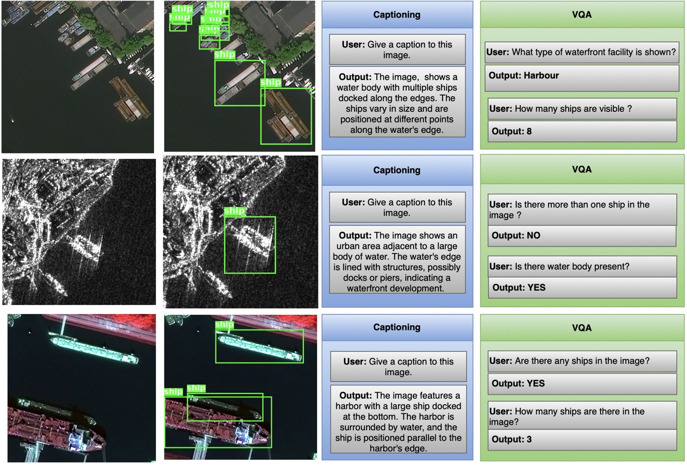
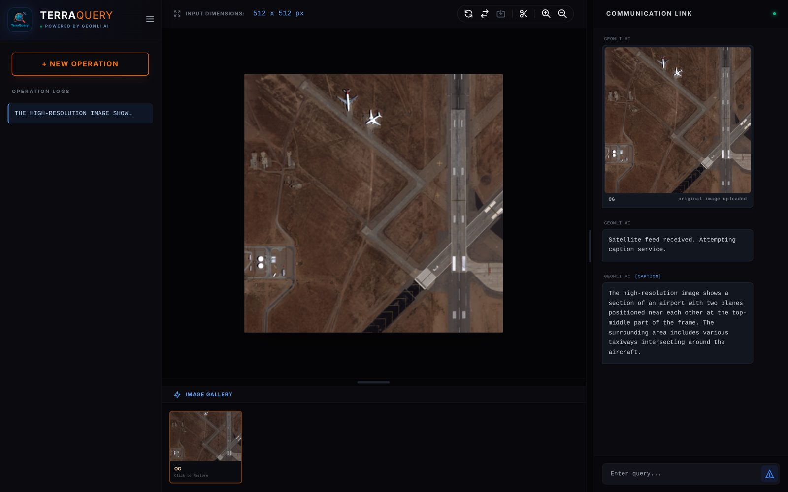
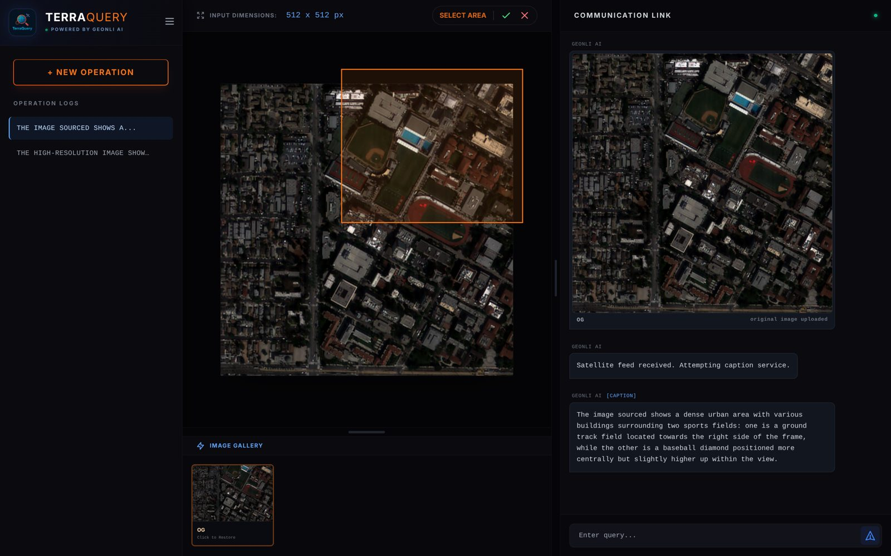
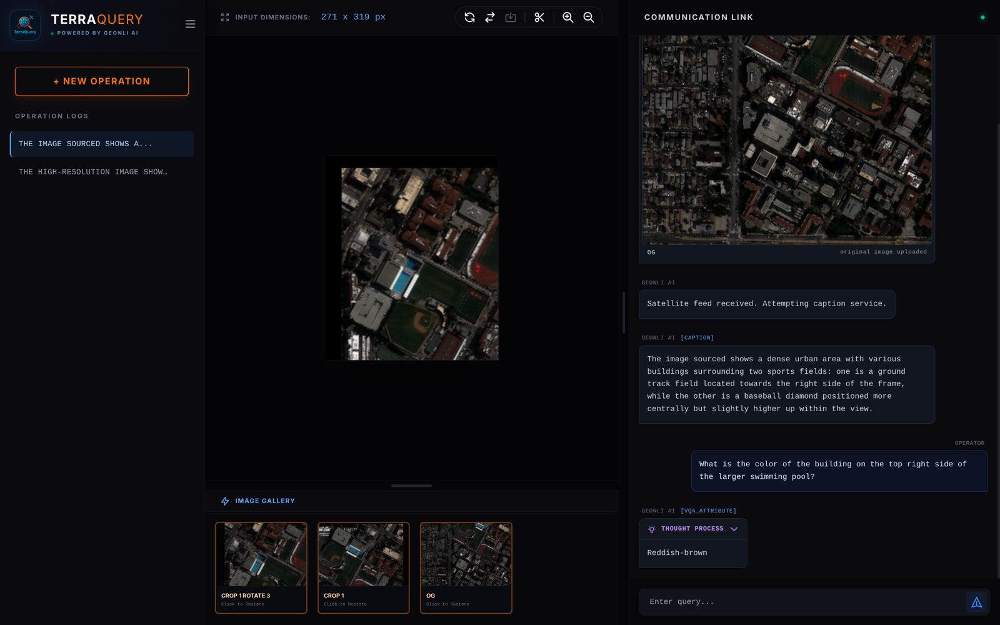

<div align="center">


# TerraQuery

### Hybrid Vision-Language Intelligence for Satellite Imagery

Ask questions about satellite images in plain English and get captions, grounded detections and tool-verified answers across **RGB, SAR and false-colour** imagery.

**🏆 1st place among 23 IITs** · Inter-IIT Tech Meet · ISRO Geospatial-AI (GeoNLI) problem statement · Team 27, IIT Delhi

<p>
  
  
  
  
  
  
  
  
</p>

[Report (PDF)](docs/TerraQuery_Report.pdf) · [User Guide (PDF)](docs/User_Guide.pdf) · [Deployment](docs/deployment.md) · [Fine-tuning](finetune/README.md)



</div>

---

## Overview

General-purpose VLMs struggle with satellite imagery for three reasons: **extreme scale variation**, **multiple sensing modalities** (optical, SAR, NIR composites), and the need for **precise geometric output** rather than vague descriptions. TerraQuery handles all three by combining:

- **Qwen3-VL-8B** with a *mixture of domain LoRA adapters* for SAR grounding, optical captioning and SAR captioning, hot-swapped per request.
- **Dual-stream SAM 3 segmentation**, fused by a novel **IoM-based parent-child mask-merging** algorithm.
- A **LangChain ReAct agent** that hands distances, rankings and arithmetic to symbolic tools instead of letting the VLM guess numbers.
- A **ResNet50 modality classifier** that detects RGB, SAR or false-colour input and routes it to the right adapter and sensor-aware prompt automatically.

Inference runs entirely on self-hosted checkpoints with **no external APIs**, so the system can be deployed air-gapped.

## Highlights

| | |
|---|---|
| 🛰️ **Multi-modal** | RGB, SAR and NIR-R-G false-colour, detected automatically with no user input |
| 🧩 **Mixture of adapters** | Three lightweight LoRA adapters on a frozen Qwen3-VL-8B, swapped in GPU memory per request |
| 🎭 **Dual-stream segmentation** | Box+text-prompted and text-only SAM 3 streams, merged into a clean parent-child mask hierarchy |
| 🧮 **No numeric hallucination** | A ReAct loop (`Thought → Action → Observation`) with distance, relative-position and calculator tools |
| 🔒 **Offline & private** | About 30 GB of checkpoints, downloaded once. No internet needed at runtime. |
| 🖥️ **Full-stack** | React UI with crop, zoom and rotate tools, a FastAPI gateway, and GPU microservices behind Nginx |

## Architecture

<p align="center"></p>

<sub>🔥 = LoRA-adapted · ❄️ = frozen</sub>

1. **Modality classification.** The ResNet50 head labels the image RGB, SAR or false-colour and picks the matching adapter and sensor-physics prompt prefix.
2. **Captioning.** Qwen3-VL (with its LoRA adapter) produces a scene description that serves as global context.
3. **Feature extraction.** The same Qwen instance extracts object phrases ("shipping containers", "yellow bus") to use as segmentation prompts.
4. **Dual-stream segmentation.** SAM 3 runs twice: on Qwen-proposed boxes plus text (**set A**) and on text alone (**set B**). NMS is applied within each set.
5. **IoM mask merging.** A graph algorithm reconciles A and B, removing redundant parent masks while keeping fine-grained children.
6. **Grounding and VQA.** The merged masks, with their geometric properties, go back to Qwen. A ReAct agent calls tools for anything numeric or spatial.

### Service topology



## Example outputs

<p align="center"></p>

<sub>Rows: optical harbour · SAR port · false-colour (NIR-R-G) dock. Columns: input → grounded ships → caption → VQA.</sub>

<table>
  <tr>
    <td width="33%"></td>
    <td width="33%"></td>
    <td width="33%"></td>
  </tr>
  <tr>
    <td align="center"><sub>Auto-caption on upload</sub></td>
    <td align="center"><sub>Crop a region and query it as a new image</sub></td>
    <td align="center"><sub>Attribute VQA with the reasoning trace</sub></td>
  </tr>
</table>

## Results

**Captioning (BERT-BLEU).** The LoRA-adapted model beats base Qwen3-VL-8B on every setup.

| # | Adapter params | Train data | Test data | Base | **+ LoRA** |
|:-:|:-:|---|---|:-:|:-:|
| 1 | 50M / 8B | EarthBench RGB | VRSBench RGB | 0.668 | **0.701** |
| 2 | 50M / 8B | EarthMind SAR pairs | EarthMind SAR pairs | 0.781 | **0.803** |
| 3 | 1.5M / 8B | EarthMind-Bench SAR+RGB | VRSBench RGB | 0.671 | **0.692** |
| 4 | 1.5M / 8B | EarthMind-Bench SAR+RGB | EarthMind SAR pairs | 0.772 | **0.797** |

**VRSBench, scored with the GeoNLI criteria**

| Task | Metric | Score |
|---|---|:-:|
| Captioning | BERT-BLEU-4 | 0.701 |
| Grounding | Count penalty × mean IoU | 0.334 |
| Attribute (binary) | Exact match | 0.782 |
| Attribute (numeric) | Exp. relative error | 0.705 |
| Attribute (semantic) | BERT-BLEU-1 | 0.637 |
| **Final weighted score** | Composite | **0.577** |

<details>
<summary><b>Metric definitions</b></summary>

- **BERT-BLEU**: BLEU-style n-gram precision computed on BERT embeddings, with length penalty `LP = exp(−0.5·|L_c − L_r| / L_r)`. Semantic attributes use n=1 because answers are 1–3 words.
- **Grounding**: `CP × MeanIoU`, where `CP = exp(−2.5·|N_pred − N_ref|)` penalises miscounts.
- **Numeric**: `exp(−23·|x_pred − x_gt| / x_gt)`, so a 10% error scores about 0.1.
- **Binary**: exact match.

</details>

## Key ideas

<details open>
<summary><b>IoM-based mask merging</b> (<code>vqa/mask_merging.py</code>)</summary>

The two SAM 3 streams catch different objects, so neither alone gives full coverage. Within each set, NMS guarantees no overlaps. That means every cross-set overlap is a depth-1 **parent → child** relation, scored by *Intersection over Minimum*:

```
IoM(parent, child) = |parent ∩ child| / |child|
```

For each connected component of the overlap graph:
- If the union of the children covers more than τ = 0.7 of the parent, **keep the children** (finer detail).
- If there is a single child, **keep the parent**.
- Otherwise, **geodesically dilate** the children inside the parent and re-check coverage. Any remaining uncovered regions of the parent become extra disjoint masks.

</details>

<details>
<summary><b>Mixture of LoRA adapters</b> (<code>finetune/</code>, <code>vqa/local_vlm.py</code>)</summary>

| Adapter | Data | Config | Loss |
|---|---|---|---|
| SAR grounding | MMRS SARV2, 2,400 SAR images, 540 steps | r=16, α=32, lr 2e-4 | LM cross-entropy + IoU loss + false-positive and false-negative penalties |
| Optical captioning | SpaceNet6 / VRSBench RGB | r=8, α=16 | LM cross-entropy |
| SAR captioning | 10,270 paired RGB+SAR captions (EarthMind, DFC23/25, SpaceNet6, Wuhan, M4-SIR) | r=8, α=16 | LM cross-entropy |

Adapters stay resident and are swapped in place. After each request the model drops back to a zero-initialised **null adapter**, so the base weights are never reloaded. The report measured under 5 ms per switch.

</details>

<details>
<summary><b>ReAct tool orchestration</b> (<code>vqa/local_vlm.py</code>, <code>vqa/geometric_utils.py</code>)</summary>

Each VQA mode loads its own system prompt ([`systemprompt_*.txt`](vqa/)):

- **numerical**: must call `calculate` for any arithmetic and must call tools for comparisons between objects. Mental math is forbidden.
- **attribute** / **binary**: answered from the image directly. Tools are disabled and answers are kept short.
- **filtering**: conditional queries that return mask overlays.

Tools: `compute_min_distance_between_crops` (pixel distance between two crops), `get_relative_position` (8 compass directions or same position), and `calculate` (a safe evaluator with arithmetic and `RANK[...]` / `RANK_DESC[...]` ranking modes). Per-object area, orientation, aspect ratio and centroid are precomputed from the masks, so the model reads them instead of estimating.

</details>

## Repository layout

```
TerraQuery/
├── frontend/          React 19 + Vite + Tailwind UI
├── backend/           FastAPI gateway: task routing, box drawing, answer normalisation
├── vqa/               Qwen3-VL service: orchestrator, ReAct tools, adapters, prompts
│   └── artifacts/     null-adapter configs (weights built by scripts/make_null_adapters.sh)
├── sam3/              SAM 3 service: text/box-prompted masks + IoM merging
├── classifier/        ResNet50 RGB / SAR / false-colour classifier (training + CLI)
├── finetune/          LoRA training & BERT-BLEU evaluation scripts
├── scripts/           install.sh · deploy.sh · make_null_adapters.sh
├── docs/              report, user guide, deployment guide
└── assets/            README images
```

## Getting started

### Requirements

- Ubuntu 20.04 / 22.04 / 24.04 with an NVIDIA GPU: **24 GB VRAM minimum, 32 GB recommended**, CUDA ≥ 12.6
- Python 3.10 (conda recommended) and Node 20.19+ for the frontend
- About 30 GB of disk for checkpoints (Qwen3-VL-8B about 17 GB, SAM 3 about 5.4 GB)

### 1. Install

```bash
git clone https://github.com/ambarish1729/TerraQuery.git
cd TerraQuery
conda create -n geonli python=3.10 -y && conda activate geonli
bash scripts/install.sh
```

### 2. Get the models

| Model | How |
|---|---|
| Qwen3-VL-8B-Instruct | Downloaded automatically from Hugging Face on first run |
| SAM 3 (`facebook/sam3`) | Request access on Hugging Face, then `hf auth login`. It downloads on first run. |
| Null adapters | `bash scripts/make_null_adapters.sh` (required: the VQA service attaches these at startup) |
| Domain LoRA adapters | *Not included.* Train them with [`finetune/`](finetune/README.md) and place them at `vqa/checkpoints/{normal_caption,sar_caption,sar_bbox}`. If they're missing, the service logs a warning and uses base Qwen3-VL. |
| Modality classifier | *Not included.* Train it with [`classifier/`](classifier/README.md) and set `BAND_CLASSIFIER_CHECKPOINT`. If it's missing, every image takes the RGB path. |

### 3. Run

```bash
# terminal 1: SAM 3 service
cd sam3 && cp .env.example .env && uvicorn api:app --host 0.0.0.0 --port 6767

# terminal 2: VQA service (loads Qwen3-VL once and keeps it resident)
cd vqa && cp .env.example .env && uvicorn unified_api:app --host 0.0.0.0 --port 8001

# terminal 3: backend gateway
cd backend && cp .env.example .env && uvicorn api:app --host 0.0.0.0 --port 8000 --root-path /api

# terminal 4: frontend
cd frontend && npm install && npm run build   # then serve dist/ via Nginx, see docs/deployment.md
```

Or do everything on one machine with Nginx and gunicorn:

```bash
bash scripts/deploy.sh
```

The services can also run on separate machines. Point the URLs in each `.env` at the right hosts. See [`docs/deployment.md`](docs/deployment.md).

## API

| Service | Endpoint | Purpose |
|---|---|---|
| Backend `:8000` | `POST /api/handle` | Image + prompt + chat context → routed answer |
| | `POST /api/eval` | Run benchmark queries directly, without the router |
| VQA `:8001` | `POST /router` | Classify the request: caption, attribute, numerical, binary or filtering |
| | `POST /caption` | Modality-aware caption |
| | `POST /bbox` | Grounded boxes for `object_name` |
| | `POST /vqa/{mode}` | `attribute` · `numerical` · `binary` · `filtering` |
| | `GET /health` | Reports whether the VLM is loaded |
| SAM 3 `:6767` | `POST /masks` · `/boxes` | Text-prompted masks / boxes |
| | `POST /masks_with_box(es)` | Box + text-prompted masks |
| | `POST /merged_masks` | Dual-stream generation + IoM merge |

## Limitations

- **Single-threaded inference.** Concurrent requests can corrupt the shared KV cache, so requests are served one at a time.
- **Occlusion and lookalikes.** Partially visible or visually similar objects can produce false positives.
- **Dense tiny objects.** Recall drops when a scene has many very small instances.
- **No adversarial hardening.**

## Acknowledgements

Built by **Team 27, IIT Delhi** for the ISRO Geospatial-AI (GeoNLI) problem statement at the Inter-IIT Tech Meet.

TerraQuery builds on [Qwen3-VL](https://github.com/QwenLM/Qwen3-VL) (Apache 2.0), [SAM 3](https://github.com/facebookresearch/sam3) (Meta research license), [Unsloth](https://github.com/unslothai/unsloth), [PEFT](https://github.com/huggingface/peft) and [LangChain](https://github.com/langchain-ai/langchain) (MIT). Data: SpaceNet6 (CC BY-SA 4.0), SSL4EO-S12, VRSBench, EarthMind and MMRS SARV2, each under its own license.

<details>
<summary>References</summary>

1. S. Bai *et al.*, "Qwen3-VL Technical Report," arXiv:2511.21631, 2025.
2. N. Carion *et al.*, "SAM 3: Segment Anything with Concepts," arXiv:2511.16719, 2025.
3. Y. Shu *et al.*, "EarthMind: Towards Multi-Granular and Multi-Sensor Earth Observation with Large Multimodal Models," arXiv:2506.01667, 2025.
4. W. Zhang *et al.*, "EarthGPT: A Universal Multi-Modal Large Language Model for Multi-Sensor Image Comprehension in Remote Sensing," arXiv:2401.16822, 2024.
5. Y. Wang *et al.*, "SSL4EO-S12: A Large-Scale Multi-Modal, Multi-Temporal Dataset for Self-Supervised Learning in Earth Observation," IEEE GRSM, 2023.
6. X. Li, J. Ding, M. Elhoseiny, "VRSBench: A Versatile Vision-Language Benchmark Dataset for Remote Sensing Image Understanding," NeurIPS Datasets & Benchmarks, 2024.
7. E. J. Hu *et al.*, "LoRA: Low-Rank Adaptation of Large Language Models," ICLR 2022.
8. S. Yao *et al.*, "ReAct: Synergizing Reasoning and Acting in Language Models," ICLR 2023.

</details>

## License

Source code is released under the [MIT License](LICENSE). Model weights and datasets remain under their own licenses.
